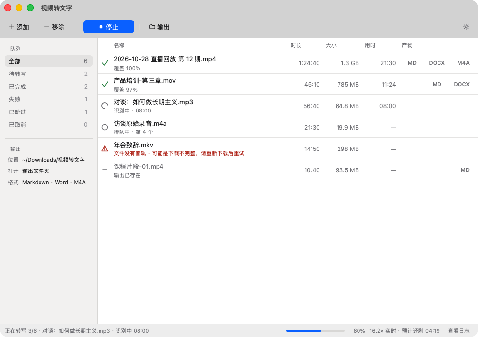
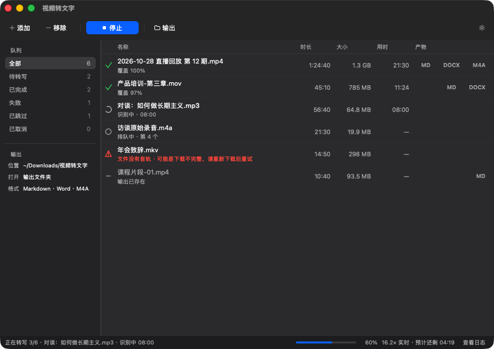

# 视频转文字

[](https://github.com/fuxm0818/video-to-text/actions/workflows/build.yml)

把本地视频或音频里的说话声，转成可编辑的 Markdown / Word 文稿，并同时导出音频文件。

原生桌面窗口，不需要浏览器；全部在本机完成，不上传、不排队、不需要账号。基于 FunASR（Paraformer + FSMN-VAD + CT-Punc）做中文语音识别。



<details>
<summary>深色模式</summary>



</details>

## 能做什么

- 选择多个文件或整个文件夹批量转写；递归读取子文件夹，也可以直接把文件、文件夹拖进窗口。
- 队列可按状态筛选（待转写 / 已完成 / 失败 / 已跳过 / 已取消），逐行查看时长、大小、用时和已经生成的产物。
- 产物默认保存到“下载/视频转文字”；工具栏“输出”、侧栏“打开”、双击任务行都可以一步打开结果，保存位置也可随时更改。
- 导出 Markdown（`.md`）与 Word（`.docx`），同时可导出 M4A（默认）或 WAV 音频。
- 每篇文稿包含：带时间轴的逐句文稿、连续文稿、以及“数据来源与局限”。
- 同一来源的文稿已存在时自动跳过；在偏好设置里勾选“重新转写已存在的文稿”可强制覆盖。
- 可以随时停止：正在处理的文件不留下不完整产物，已经完成的结果保留，未开始的标记为“已取消”。
- 失败的行可以展开完整错误；运行日志就在窗口底部，也可以单独打开日志文件。
- 界面跟随系统的浅色 / 深色外观自动切换。

支持格式：`mp4` `mov` `mkv` `webm` `avi` `m4v` `ts` `flv` `wmv` `m4a` `mp3` `wav` `aac` `flac` `ogg` `opus` `wma`。

## 下载与安装

发布页每次打 tag 会生成两个压缩包：

| 平台 | 文件 | 说明 |
| --- | --- | --- |
| macOS（Apple Silicon） | `VideoToText-macos-arm64.zip` | macOS 14 及以上，M1/M2/M3/M4 |
| Windows 10/11（64 位） | `VideoToText-windows-x64.zip` | 解压后运行 `VideoToText.exe` |

> **Intel Mac 不支持。** PyTorch 2.14 没有 macOS x86_64 的官方轮子，语音识别引擎无法在 Intel Mac 上运行。Windows ARM 也不在支持范围内。

### macOS

1. 下载 zip，解压，把 `视频转文字.app` 拖进“应用程序”。
2. 第一次打开：在 Finder 里**右键 → 打开**，或双击后到“系统设置 → 隐私与安全性”里点“仍要打开”。
3. 应用使用 ad-hoc 签名，未做 Apple 公证，所以系统会提示“无法验证开发者”。这是正常的；它**不是“已损坏”**——签名完整性已在打包与解压后校验通过。

如果确实看到“已损坏”（通常发生在下载中断或第三方解压工具改动了文件），请重新下载；不建议关闭系统安全设置。

### Windows

1. 下载 zip，**完整解压**到任意文件夹（不要直接在压缩包里运行）。
2. 双击 `VideoToText.exe`。
3. 如果出现 SmartScreen 提示，点“更多信息 → 仍要运行”。

## 第一次运行：下载语音模型

程序本身不带模型。第一次开始转写时，会从 ModelScope 下载约 **2.1 GB** 的模型：

- Paraformer 中文语音识别（约 953 MB）
- CT-Punc 断句与标点（约 1.1 GB）
- FSMN-VAD 语音端点检测（约 4 MB）

下载只需要一次，之后可以离线使用。缓存位置：

- macOS：`~/.cache/modelscope`
- Windows：`C:\Users\<用户名>\.cache\modelscope`

下载时窗口内会出现一个不阻塞操作的进度面板，显示已下载字节和预计剩余时间；可以取消，取消后本次转写不会继续。关掉面板后，点底部状态条的“查看下载进度”可以重新打开。

要在离线机器上首次使用，可以把已下载的 `modelscope` 缓存目录复制到目标机器的同一路径。

## 使用

1. **添加素材**：点工具栏“添加 ▾”，选“选择文件…”（⌘O）或“选择文件夹…”（⇧⌘O）；也可以把文件、文件夹直接拖进窗口。文件夹会递归读取。
2. **设置输出**：默认保存在“下载/视频转文字”。点左侧“位置”可以更换保存目录，点“打开”直接打开输出文件夹；点“格式”打开格式设置，也可以按 ⌘, 打开偏好设置。文稿至少选 Markdown 或 Word 之一，音频可选 M4A、WAV 或不导出。
3. **开始转写**：点“开始转写”（⌘↩）。列表里正在处理的文件会显示当前阶段和已用时间；底部状态条显示按素材时长加权的总进度、速度和预计剩余时间。速度和剩余时间都是估算值，素材差异大时会有偏差。
4. **运行中**：按钮变成“停止”（⌘.）。停止立即生效：当前文件不留下不完整的产物，已完成的结果保留，未开始的文件标记为“已取消”。运行期间不能添加或移除素材，对应操作会禁用。
5. **查看结果**：点任务行尾的 MD / DOCX / M4A 按钮直接打开对应产物，或双击任务行打开主文稿；工具栏常驻的“输出”按钮和底部“打开输出文件夹”随时打开保存目录。失败的行点左侧状态图标可展开完整错误；“查看日志”会展开底部日志抽屉。

偏好设置 → 性能里可以设置同时转写的文件数（1–4）和是否强制重新转写。并发 2 能提高总吞吐但更吃内存，16 GB 内存建议 1–2。

输出文件命名与源文件同名；重名时自动加 `(2)` 等后缀，不会覆盖无关文件。

## 命令行（源码用户）

需要 Python 3.12、ffmpeg，并安装依赖：

```bash
git clone https://github.com/fuxm0818/video-to-text.git
cd video-to-text
python3.12 -m venv .venv
.venv/bin/python -m pip install -r requirements.txt
.venv/bin/python -m pip install -e .
```

无界面批量转写：

```bash
video-to-text transcribe "/path/to/视频目录" -o output --formats md,docx --audio m4a
```

常用参数：

- `--formats md,docx`：文稿格式；留空表示只要音频
- `--audio m4a|wav|none`：音频导出格式
- `--force`：已有文稿也重新转写

启动桌面窗口：

```bash
video-to-text
```

其他参数：`--output <目录>`（覆盖默认保存位置）、`--self-test`（安装自检）。

### 从源码打包

```bash
python packaging/fetch_ffmpeg.py          # 下载当前平台的静态 ffmpeg
pyinstaller packaging/video_to_text.spec --noconfirm --distpath dist --workpath build
```

macOS 产物是 `dist/视频转文字.app`，Windows 产物是 `dist/VideoToText/`。CI 会为 tag 自动构建并发布两个平台的 zip（见 `.github/workflows/build.yml`）。

## 隐私

- 界面是本地桌面窗口，程序不监听任何网络端口，也不会启动本地 Web 服务。
- 音视频与文稿不会离开本机。
- 唯一的联网行为是首次运行时从 ModelScope 下载模型；之后完全离线。

## 已知限制

- **只做语音识别，不做画面 OCR**：画面上的字幕、标题不会被读取。
- 语音识别未经人工校对，专有名词、同音字、人名地名可能出错；每篇文稿都附有这一说明。
- 识别结果覆盖的是“检测到人声”的片段；纯音乐、静音、噪声段不会产生文字，覆盖率会低于 100%。
- 模型以中文为主，中英混说通常可用；纯英文、强口音、多人抢话、背景噪声大的素材效果会下降。
- 没有 GPU 加速，使用 CPU。8 核 Apple Silicon 实测约为素材时长的 6–9 倍速（单文件）；并发 2 路可提高总吞吐，但更吃内存（16 GB 建议并发 1–2）。
- macOS 包只支持 Apple Silicon；Windows 包由 CI 构建并已跑通打包自检，但没有 Windows 实机验收，长时间批量任务请在正式使用前先小批量试跑。

## 验证状态（2026-10-30）

- 界面改版（2026-10-30）：macOS Apple Silicon 原生窗口完成浅色 / 深色视觉验收，截图取自真实窗口（`docs/screenshot.png`、`docs/screenshot-dark.png`），不是效果图，且已按 1.0 的新工具栏与“打开”入口重拍；源码自检退出码 0；测试共 46 项全部通过（不加载模型，覆盖任务队列、输出路径迁移与离屏 Qt 界面）。
- 仓库审查（2026-10-30）：CI 在 push / pull request 时于 Ubuntu、macOS arm64、Windows 三平台运行测试，只有打 tag 或手动触发才构建安装包；ffmpeg 下载按 PyPI 公布的 SHA-256 校验；应用版本号统一取自 `pyproject.toml`。
- 打包：`dist/视频转文字.app` 已用 PyInstaller 6.22.3 按当前 spec 重建（版本号读取自 `pyproject.toml`），自检全项通过（ffmpeg、torch / FunASR / ModelScope、多进程、音频抽取与 M4A、断句标点、Markdown、DOCX、Qt、图标）；ad-hoc 签名 `codesign --verify --deep --strict` 通过；重新启动后确认新工具栏、侧边栏、空状态与底部状态条渲染正常。重新生成的 `VideoToText-macos-arm64.zip` 解压后签名验证与自检同样通过，SHA-256 见 `SHA256SUMS.txt`。
- 转写内核（2026-10-25）：同一 ASR 内核跑过真实 28 分钟中文音频（396 段，覆盖 98%），以及 29 秒中文口播端到端（md + docx + m4a，3 段，覆盖 85%），取消任务后状态为“已取消”。本次只改界面与队列控制，未改动转写和产物链路；但**尚未用新界面跑真实素材**，界面与队列联动的真实长跑待补。
- CI 全量构建（2026-10-30，[run 40994108980](https://github.com/fuxm0818/video-to-text/actions/runs/40994108980)）：手动触发后三平台测试与 macOS / Windows 打包全部成功，`release` 按设计跳过（未打 tag）。CI 产出的 macOS 包版本号 `0.1.0`、ad-hoc 签名、`--self-test` 全项通过；Windows 包 `self-test` 退出码 0，包内含 `VideoToText.exe`、`ffmpeg.exe`、`Qt6Core.dll` 与 `plugins/platforms/qwindows.dll`，下载后 SHA-256 与 CI 记录一致（`1D6F81DB…019392D`）。
- Windows x64：打包链路已在 GitHub Actions 实际跑通，但本机没有 Windows 实机，**尚未做真人交互与长批量验收**；正式使用前请先小批量试跑。

## 项目结构

```
src/video_to_text/
  app.py        命令行入口、批量转写、安装自检
  core.py       ffmpeg 探测与抽音、FunASR 识别、断句标点、Markdown/DOCX 渲染
  jobs.py       任务队列、并发 worker、取消、模型下载进度
  config.py     偏好设置持久化
  gui/          Qt 桌面窗口（窗口、任务表、侧边栏、状态条、偏好设置、模型面板）
  tokens.py     浅色 / 深色设计 token
  styles.py     由 token 生成 QPalette 与 QSS
packaging/      PyInstaller spec、启动器、ffmpeg 获取、第三方许可证
tests/          单元测试（不加载 ASR 模型，可在 CI 上跑）
```

数据流：选择文件 → `core.collect_media` 展开与排序 → `JobManager.start` 分配输出名并拉起 spawn worker → `core.transcribe_file`（抽音频 → 语音识别 → 断句标点 → 写 Markdown/DOCX + 导出音频）→ 事件回传窗口刷新进度。

重依赖（torch / funasr / modelscope）都在函数内延迟导入，窗口启动和测试不需要加载模型。

## 开发与测试

```bash
python -m unittest discover -s tests -v
```

测试不加载模型，共 42 项，覆盖 ffmpeg 探测回退、断句、Markdown/DOCX 结构、配置校验、任务队列（运行中禁改队列、只重跑指定文件、统计模型缓存字节）、版本号一致性，以及离屏 Qt 界面冒烟测试（添加素材、状态筛选、移除、偏好设置持久化、浅色 / 深色样式构建）。

## 许可

应用代码使用 MIT License，见 [LICENSE](LICENSE)。

打包产物内含第三方组件：ffmpeg 是以独立可执行文件形式分发的 GPLv2+ 构建；界面库 Qt / PySide6 以 LGPLv3 动态链接、未修改并随包分发。完整清单与许可证说明见 [NOTICE](NOTICE)，许可证全文见压缩包内的 `LICENSE.GPL-2.0.txt` 与 `LICENSE.LGPL-3.0.txt`（源码中位于 `packaging/`）。

## 致谢

- [FunASR](https://github.com/modelscope/FunASR) 与 [ModelScope](https://modelscope.cn/)：语音识别、端点检测与标点模型
- [PyTorch](https://pytorch.org/)：推理运行时
- [Qt for Python (PySide6)](https://doc.qt.io/qtforpython/)：原生桌面界面
- [FFmpeg](https://ffmpeg.org/)：音频抽取与转码
- [imageio-ffmpeg](https://github.com/imageio/imageio-ffmpeg)：跨平台静态 ffmpeg 构建
